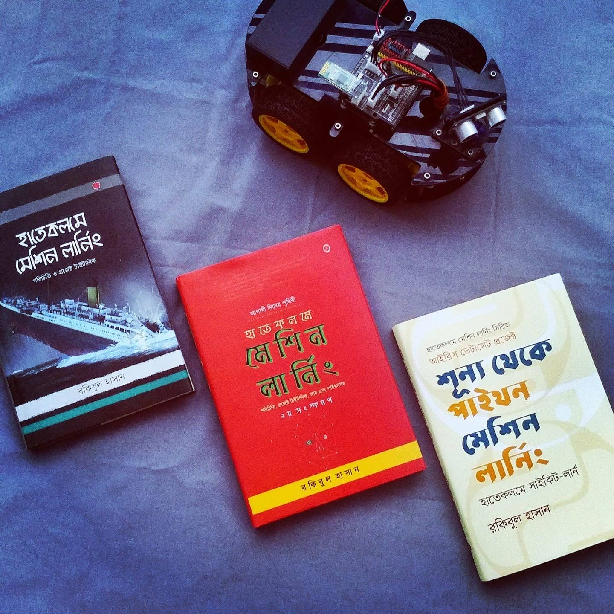

# হাতেকলমে মেশিন লার্নিং

(আর এবং পাইথন প্রোগ্রামিং এনভায়রনমেন্ট)

## *বিশ্বসেরা প্রজেক্ট 'টাইটানিক '*

> A breakthrough in machine learning would be worth ten Microsofts.
>
> — Bill Gates

!!! info
    *খসড়া ভার্সন: ১.০০ রিভিশন ৩। সময়সীমা: ফেব্রূয়ারি -নভেম্বর ২০১৬*
    
    *খসড়া ভার্সন: ২.০০ রিভিশন ৭। সময়সীমা: জুন - অক্টোবর  ২০১৭*
    
    *খসড়া ভার্সন: ৩.০০ রিভিশন ১২। সময়সীমা: নভেম্বর - জানুয়ারি ২০১৮*

!!! info "সংস্করণ ও রেফারেন্স তথ্য"
    **দ্বিতীয় সংস্করণ (প্রিন্ট এডিশন):** [রকমারি থেকে সংগ্রহ করুন :octicons-link-external-16:](https://rokomari.com/book/174186/)  
    **প্রথম সংস্করণ (আর্কাইভ):** [রকমারি লিঙ্ক :octicons-link-external-16:](https://www.rokomari.com/book/160337/)  

    <small style="opacity: 0.8; display: block; margin-top: 8px; font-size: 0.85em; border-top: 1px dashed var(--md-default-fg-color--lightest); padding-top: 6px;">
    ℹ️ <em>বইটি মূলত <a href="https://rakibul-hassan.gitbook.io/mlbook-titanic" target="_blank" rel="noopener">গিটবুকের পুরনো প্ল্যাটফর্মে</a> প্রকাশিত হয়েছিল। পরবর্তীতে সম্পূর্ণ কনটেন্ট আধুনিকায়নের অংশ হিসেবে এই নতুন সাইটে মাইগ্রেট করা হয়েছে।</em>
    </small>

> গিটহাব স্ক্রিপ্ট সব ঠিকমতো চলছে

(আসল "টেবিল অফ কনটেন্ট" বাঁ পাশের প্যানে। মোবাইলের জন্য একটু স্ক্রল ডাউন করে চাপ দিন ওপরের "লিস্ট" বাটন) [দেখুন ভিডিও।](https://www.facebook.com/mltraining/videos/757857641090247/)

প্রয়োজনীয় যোগাযোগ: <https://github.com/raqueeb>&#x20;

ইঊটিঊব চ্যানেল <https://goo.gl/aiWJso>&#x20;
